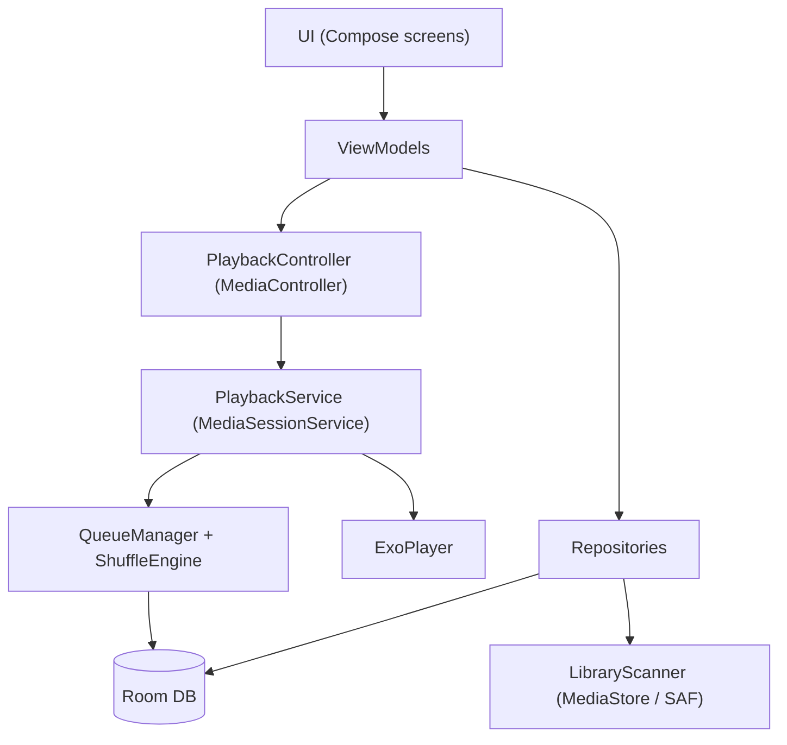

# Architecture & Project Structure

## 1. Prinsip
- Android-only, Kotlin, Jetpack Compose.
- **Satu sumber kebenaran untuk queue:** state queue dimiliki player service, bukan UI.
- UI hanya mengamati state (`StateFlow`) dan mengirim aksi, mirip pola React.
- Pola: MVVM + Repository, dengan unidirectional data flow.

## 2. Diagram Lapisan



## 3. Modul / Package

Mulai dengan satu module `app`, dipisah per package. Pecah ke multi-module hanya jika perlu.

```
app/src/main/java/com/yourname/musicplayer/
├── MusicApp.kt                  # Application class (Hilt)
├── MainActivity.kt
├── data/
│   ├── db/
│   │   ├── AppDatabase.kt
│   │   ├── dao/                 # TrackDao, AlbumDao, PlaylistDao, QueueDao
│   │   └── entity/              # TrackEntity, PlaylistEntity, QueueItemEntity
│   ├── scanner/LibraryScanner.kt
│   ├── repository/              # LibraryRepository, PlaylistRepository
│   └── prefs/SettingsStore.kt   # DataStore
├── domain/
│   ├── model/                   # Track, Album, Artist, QueueState
│   └── shuffle/
│       ├── ShuffleEngine.kt     # interface
│       ├── PureShuffle.kt
│       └── SmartShuffle.kt      # hindari artis/album berturutan
├── playback/
│   ├── PlaybackService.kt       # MediaSessionService
│   ├── PlaybackController.kt    # wrapper MediaController untuk UI
│   ├── QueueManager.kt          # reorder, remove, jump-to
│   └── SleepTimer.kt
├── ui/
│   ├── theme/
│   ├── navigation/
│   ├── library/                 # Albums, Artists, Folders, Tracks
│   ├── nowplaying/              # NowPlayingScreen + QueueSheet
│   ├── playlist/
│   └── components/              # TrackRow, MiniPlayer, DragHandle
└── di/                          # Hilt modules
```

## 4. Data Model

| Entity | Field utama |
|---|---|
| `TrackEntity` | id, uri, title, artist, album, albumArtist, trackNo, discNo, durationMs, format, sampleRate, bitrate, folderPath, dateAdded |
| `PlaylistEntity` | id, name |
| `PlaylistTrackCrossRef` | playlistId, trackId, position |
| `QueueItemEntity` | position, trackId, queueItemUid |

Queue disimpan ke DB agar bertahan setelah app dimatikan. Beri `queueItemUid` unik agar lagu yang sama boleh muncul dua kali.

## 5. Queue & Shuffle (inti app)

**Alur saat shuffle dinyalakan**
1. Ambil sumber (album, folder, atau seluruh library).
2. `ShuffleEngine.shuffle(tracks, currentTrack)` menghasilkan urutan fix.
3. Lagu yang sedang diputar ditaruh di posisi 0.
4. Urutan dimasukkan ke playlist ExoPlayer dan disimpan ke tabel queue.

**Operasi queue** (via `QueueManager`, memanggil `Player.moveMediaItem`, `removeMediaItem`, `seekTo`)
- Reorder lewat drag.
- Remove lewat swipe.
- Tap untuk lompat ke lagu.
- "Play next" dan "Add to queue".

**Smart shuffle:** untuk setiap slot, pilih kandidat acak. Jika artis atau album sama dengan lagu sebelumnya, ambil ulang sampai N kali. Slider "randomness" mengatur kekuatan penghindaran.

## 6. Playback Service
- `PlaybackService : MediaSessionService` berjalan sebagai foreground service dengan notifikasi media.
- UI terhubung lewat `MediaController`, jadi playback tetap hidup saat Activity ditutup.
- Gapless: ExoPlayer menanganinya untuk FLAC. Uji dengan album gapless.
- Sleep timer: coroutine dengan delay lalu `pause()`, opsi "selesai di akhir lagu".

## 7. Scanning Library
- Pakai `MediaStore.Audio` untuk indeks cepat.
- Metadata tambahan (disc number, album artist, sample rate) dibaca dengan `MediaMetadataRetriever` atau library tag.
- Scan inkremental berdasarkan `DATE_MODIFIED`, dijalankan di `WorkManager` atau coroutine.
- Izin: `READ_MEDIA_AUDIO` (Android 13+), `READ_EXTERNAL_STORAGE` untuk versi lama.

## 8. Layar v1
1. **Library:** tab Albums, Artists, Folders, Tracks.
2. **Now Playing:** cover, kontrol, tombol shuffle dan repeat.
3. **Queue sheet:** daftar Up next dengan drag, swipe, dan tap.
4. **Playlists:** daftar dan detail.
5. **Settings:** smart shuffle, sleep timer, folder scan.

## 9. Dependensi Utama
- `androidx.media3:media3-exoplayer`, `media3-session`, `media3-ui`
- `androidx.room:room-runtime`, `room-ktx`, `room-compiler` (KSP)
- `androidx.compose` BOM + Material 3
- `io.coil-kt:coil-compose`
- `androidx.datastore:datastore-preferences`
- `sh.calvin.reorderable:reorderable` (drag-reorder di Compose)
- Hilt (opsional)

## 10. Risiko dan Catatan
| Risiko | Mitigasi |
|---|---|
| Scan 3.000+ file lambat | Scan inkremental dan cache di Room |
| Queue besar (1.000+ item) membuat UI lag | `LazyColumn` dengan key, batasi tampilan |
| Kill oleh OEM battery saver | Foreground service dan panduan whitelist |
| USB audio di v2 | Siapkan abstraksi `AudioOutput` agar mudah diganti nanti |

