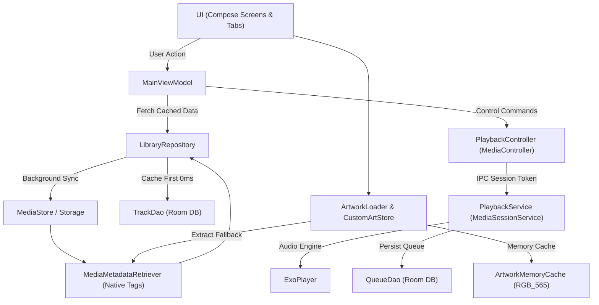

# Architecture & Project Structure

## 1. Prinsip Arsitektur
- **Android-only:** 100% native Kotlin dan Jetpack Compose modern.
- **Single Source of Truth untuk Playback & Queue:** State pemutaran dan antrean sepenuhnya dimiliki oleh `PlaybackService` (`MediaSessionService`). UI hanya mengamati melalui `StateFlow` unidirectional data flow.
- **Offline-First Room DB Caching:** Seluruh metadata library dan antrean tersimpan di database lokal (Room SQLite). Startup instan 0ms saat aplikasi dibuka tanpa menunggu scanner sistem.
- **Bit-Perfect Audio Philosophy & ReplayGain:** Tidak ada equalizer bawaan untuk menjaga integritas dan kemurnian sinyal audio asli; normalisasi kenyaringan volume otomatis membaca tag ReplayGain/R128.
- **Preservasi State:** Menggunakan `SaveableStateHolder` di tingkat root layar, tingkat detail view, dan tingkat tab untuk menjaga posisi scroll pengguna.

---

## 2. Diagram Alur Data



---

## 3. Struktur Modul & Package

```
app/src/main/java/com/prinzeugen/nitorimusic/
├── data/
│   ├── db/
│   │   ├── AppDatabase.kt          # Database Room v2 (Queue & Tracks)
│   │   ├── dao/
│   │   │   ├── TrackDao.kt         # Operasi CRUD cache metadata
│   │   │   └── QueueDao.kt         # Operasi persistensi antrean
│   │   └── entity/
│   │       ├── TrackEntity.kt      # Tabel cache lagu & album
│   │       └── SavedQueueItem.kt   # Tabel urutan antrean aktif
│   ├── cue/
│   │   └── CueSheetParser.kt       # Parser CUE sheet (eksperimental)
│   ├── ArtworkLoader.kt            # Multi-tier fallback cover art
│   ├── CustomArtworkManager.kt     # Manajemen custom art & LruCache
│   ├── LibraryRepository.kt        # Repository offline-first
│   └── SettingsStore.kt            # DataStore preferensi audio & UI
├── domain/
│   ├── model/
│   │   ├── Track.kt, Album, Artist, Folder
│   │   └── LibrarySort.kt, ViewLayout, ListOptions
│   └── shuffle/
│       └── SmartShuffle.kt         # Algoritma penyebaran artis/album
├── playback/
│   ├── PlaybackService.kt          # Foreground MediaSessionService + ReplayGain
│   └── PlaybackController.kt       # Wrapper MediaController, AudioSpecs, SleepTimer
└── ui/
    ├── AppRoot.kt                  # Navigasi utama & Screen SaveableStateHolder
    ├── MainViewModel.kt            # ViewModel induk pengelola state
    ├── TimeFormat.kt               # Helper format durasi mm:ss
    ├── components/
    │   ├── FastAlphabetScroller.kt # Fast A-Z Indexer scroller bar & bubble
    │   ├── ArtworkImage.kt         # Image Composable multi-fallback
    │   ├── PowerampBottomBar.kt    # Bottom bar permanent 3-row
    │   └── TrackActionMenu.kt      # Menu opsi cepat per lagu
    ├── library/
    │   ├── LibraryScreen.kt        # Tab row, toolbar, SaveableStateHolder tabs
    │   ├── AlbumsTabContent.kt     # Grid/List album + Bulk Selection + A-Z Scroller
    │   ├── AlbumActionDialog.kt    # Dialog context detail album
    │   ├── TracksTabContent.kt     # Grid/List lagu + Bulk Selection + A-Z Scroller
    │   ├── ArtistsTabContent.kt    # Daftar artis + A-Z Scroller
    │   ├── FoldersTabContent.kt    # Daftar folder
    │   ├── AlbumDetailScreen.kt    # Detail isi album
    │   ├── ArtistDetailScreen.kt   # Detail isi artis
    │   ├── FolderDetailScreen.kt   # Detail isi folder
    │   └── SearchDialog.kt         # Pencarian lagu cepat
    ├── nowplaying/
    │   ├── NowPlayingScreen.kt     # Player view, Palette ambient, Gesture swipe-down
    │   ├── QueueScreen.kt          # Reorderable queue drag-drop
    │   └── SleepTimerDialog.kt     # Dialog pilihan timer tidur
    └── settings/
        └── SettingsScreen.kt       # Layar konfigurasi audio (ReplayGain) & library
```

---

## 4. Model Data Utama

| Model / Entity | Field Kunci | Keterangan |
|---|---|---|
| `TrackEntity` | `id`, `uri`, `title`, `artist`, `album`, `albumId`, `durationMs`, `trackNo`, `year`, `dateAddedSec`, `folderPath` | Menyimpan cache offline library |
| `SavedQueueItem` | `position`, `mediaId`, `title`, `artist` | Menyimpan antrean aktif secara persisten |
| `AudioSpecs` | `codec`, `sampleRateHz`, `bitDepth`, `bitrateKbps`, `channelCount` | Spesifikasi decoding real-time audio |
| `Album` | `id`, `title`, `artist`, `year`, `trackCount`, `coverTrackId` | Agregasi album turunan dari Track |

---

## 5. Mekanisme State Preservation (Posisi Scroll)
Menggunakan **`SaveableStateHolder`**:
1. **Screen-level (`AppRoot`):** `screenSaveableStateHolder.SaveableStateProvider(screen)` mempertahankan scroll library saat membuka Now Playing, Queue, atau Settings.
2. **Detail-level (`LibraryScreen`):** `detailStateHolder.SaveableStateProvider(currentDetailKey)` mempertahankan list album/artis saat masuk ke halaman detail lagu lalu menekan tombol Back.
3. **Tab-level (`LibraryScreen`):** `tabStateHolder.SaveableStateProvider(currentTab)` mempertahankan scroll masing-masing tab secara independen saat berpindah tab.
